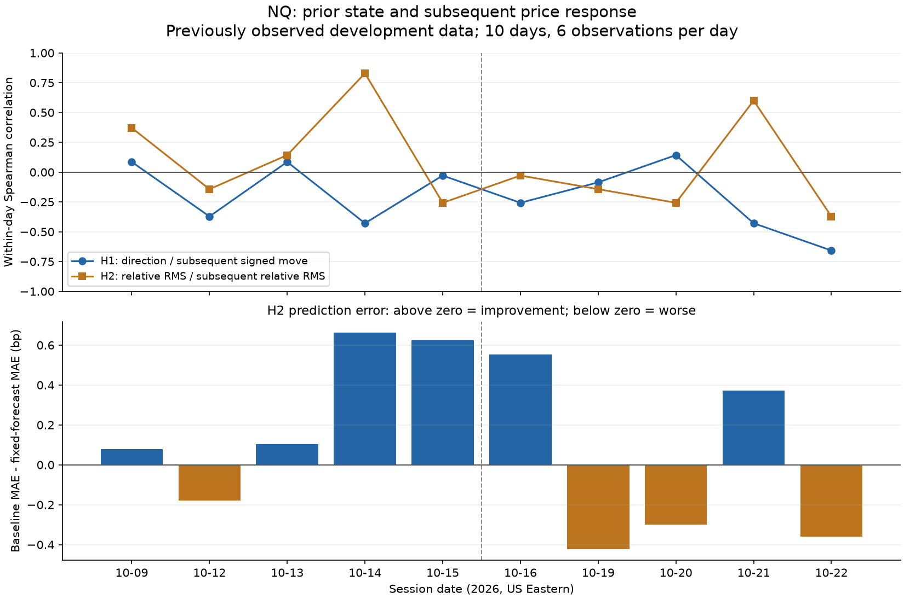

# NQ 사전 상태 → 후속 가격 반응 연구 — 2026-10-25

**사전 등록한 두 가설 모두 이번 개발표본의 일관성 기준을 충족하지 못했다.** 단순한 방향 지속이나 직전 변동 규모만으로 매매 규칙을 만들 근거가 부족하다. 변동 규모 예측의 전체 평균 오차는 줄었지만 최근 구간에서 개선이 유지되지 않았다.

## 먼저 고정한 연구 질문

가설은 기초 시장 상태 보고서를 본 뒤 만들었고, 이번 후속 반응 계산 전에 등록했다. 원자료는 이미 전략 개발에 쓰였으므로 등록했다고 독립 검증이 되는 것은 아니다. 이 연구는 결과값을 실제로 조사한 탐색 연구이며, 단순 데이터 품질 점검으로 계산하지 않았다.

| 가설 | 미리 관측하는 상태 | 이후 반응 |
|---|---|---|
| H1 방향·강도 지속 | 직전 30분 순변화 / 절대 종가 이동 합 | 1분 공백 뒤 30분의 방향을 포함한 로그 가격 변화 |
| H2 변동 규모 지속 | 직전 30분 RMS / 이전 5일 같은 구간 RMS 중앙값 | 이후 30분 RMS / 이전 5일 같은 미래 구간 RMS 중앙값 |

H1은 부호를 포함한 방향 효율의 관계다. “절대 효율이 높으면 승률이 높다”는 다른 질문을 시험하지 않았다. H2는 방향 예측이 아니라 움직임 규모의 관계다. 거래 압력 지속·변동 규모 군집은 가능한 설명으로 놓았으며, Last 가격으로 그 원인을 식별한 것은 아니다.

## 시각과 표본

- NQ DEC26, 미국 동부 ET. 매일 10·11·12·13·14·15시의 동일한 여섯 시각을 사용했다. 앞선 보고서에서 눈에 띈 시간대만 골라 쓰지 않았다.
- 예를 들어 10:00 상태는 09:30–09:59 봉만 사용한다. 10:00 봉은 통째로 제외하고, 반응은 10:01 첫 가격부터 10:30 마지막 가격까지다. 반응 전체는 10:31 이후에 알 수 있다.
- 첫 5일(10월 2·5·6·7·8일)은 기준값 준비용이다. 평가한 10일은 10월 9·12·13·14·15·16·19·20·21·22일이다.
- “전반 5일”과 “최근 5일”은 모두 개발자료다. 각 시점의 정상화·예측에는 현재 날짜보다 앞선 5일만 사용했다.
- 평가 관측은 60개지만, 주 집계 단위는 10개 날짜다. 일별 순위상관은 단 6쌍으로 계산해 거칠다. 반응 창은 서로 겹치지 않아도 같은 날 관측은 독립이라고 볼 수 없다.
- 가격은 보존된 Last 1분 OHLCV다. 구간 첫 시가를 기준으로 한 관측이며 실제 진입·청산 체결 가격으로 간주하지 않는다.

## 주 결과

| 지표 | 전체 10일 | 전반 5일 | 최근 5일 |
|---|---:|---:|---:|
| H1 일별 순위상관 중앙값 | -0.171 | -0.029 | -0.257 |
| H2 일별 순위상관 중앙값 | -0.086 | 0.143 | -0.143 |
| H2 기준 예측 MAE (bp) | 1.039 | 0.923 | 1.156 |
| H2 상태 반영 예측 MAE (bp) | 0.926 | 0.665 | 1.188 |
| H2 오차 개선: 기준−상태 반영 (bp) | 0.113 | 0.258 | -0.031 |

H1의 방향 일치 관측은 28/60개(46.7%), 반대 방향은 32개였다. 이번 표본의 중립·과거 방향 미정의 관측은 각각 0개다. 이 비율은 거래 승률이 아니다. 수수료·스프레드·손절·청산 규칙을 넣지 않았다.

H2 기준 예측은 이전 5일의 동일 미래 구간 RMS 중앙값이다. 상태 반영 예측은 이 기준값에 현재 상대 RMS를 그대로 곱했다. 배율 계수는 1로 고정했고 최적화하지 않았다. MAE는 RMS 예측값과 실제 RMS의 절대 오차다. bp는 1분 로그 변화 규모의 단위이며 손익 단위가 아니다.

전체 오차는 1.039→0.926bp로 줄었지만, 최근 5일은 1.156→1.188bp로 커졌다. 전체에서 오차가 줄어든 날은 6/10일, 최근에는 2/5일이었다.

## 합산 수치가 감출 수 있는 차이

60개 관측을 합치면 H2 순위상관은 0.498로 양수다. 그러나 일별 6개 시점을 비교한 상관의 중앙값은 -0.086, 최근 5일은 -0.143다. 두 집계는 서로 다른 관계를 측정한다. 이 차이는 날짜 간 변동 규모 차이가 합산 관계에 영향을 주었을 가능성을 시사하지만, 이번 연구로 그 원인을 확정하지 않는다.

따라서 합산 양의 상관만으로 “장중 변동 확대 신호가 다음 구간을 잘 예측한다”고 채택하지 않는다. 반대로 H1의 음수 값을 보고 같은 표본에서 바로 역추세 전략으로 전환하지도 않는다.

점선은 전반 5일과 최근 5일의 구분이다. 상단은 각 날짜의 6개 관측으로 계산한 순위상관, 하단은 기준 예측 대비 변동 규모 예측의 오차 개선이다. 두 구간 모두 개발자료다.

| 날짜 | H1 순위상관 | H2 순위상관 | 방향 일치/유효 관측 | H2 오차 개선 (bp) |
|---|---:|---:|---:|---:|
| 2026-10-09 | 0.086 | 0.371 | 4/6 | 0.080 |
| 2026-10-12 | -0.371 | -0.143 | 1/6 | -0.180 |
| 2026-10-13 | 0.086 | 0.143 | 4/6 | 0.105 |
| 2026-10-14 | -0.429 | 0.829 | 2/6 | 0.663 |
| 2026-10-15 | -0.029 | -0.257 | 3/6 | 0.623 |
| 2026-10-16 | -0.257 | -0.029 | 3/6 | 0.554 |
| 2026-10-19 | -0.086 | -0.143 | 4/6 | -0.423 |
| 2026-10-20 | 0.143 | -0.257 | 3/6 | -0.300 |
| 2026-10-21 | -0.429 | 0.600 | 1/6 | 0.373 |
| 2026-10-22 | -0.657 | -0.371 | 3/6 | -0.361 |

## 계산 전 정한 판단 기준과 결정

두 가설 모두 전체·전반·최근 일별 상관 중앙값과 날짜 하나씩 제외한 중앙값이 양수여야 한다고 정했다. H2에는 같은 구분에서 예측 오차가 개선되어야 한다는 조건도 붙였다. 이는 탐색 일관성 기준이며 통계적 유의성 기준이나 수익성 인증이 아니다.

- H1: 전체·전반·최근의 상관 중앙값이 모두 음수여서 기준 미충족. 이 고정된 질문을 전략 후보로 승격하지 않았다.
- H2: 합산 평균 오차 개선은 있지만 일별 관계와 최근 구간의 오차 개선이 유지되지 않아 기준 미충족. 현재의 고정 배율 예측을 채택하지 않았다.
- 어느 결과도 추세 추종 전체나 변동성 군집 자체가 존재하지 않는다는 증거가 아니다. 이 상품·기간·시각·관측 길이·정의에 한정한 개발 결과다.
- 기존 후보와 미래 검증 예약은 유지했다. 이번 결과를 근거로 시간대·관측 길이·기준값을 바꿔 재시험하지 않았다.

## 시각별 진단 — 선택 기준 아님

| ET 시각 | H1 전체 10일 상관 | H2 전체 10일 상관 | H2 평균 오차 개선 (bp) |
|---|---:|---:|---:|
| 10:00 | -0.139 | 0.745 | 0.316 |
| 11:00 | 0.382 | 0.503 | 0.330 |
| 12:00 | 0.539 | 0.891 | -0.010 |
| 13:00 | -0.018 | 0.370 | -0.121 |
| 14:00 | -0.115 | 0.794 | 0.120 |
| 15:00 | -0.345 | 0.176 | 0.045 |

시각별 값은 모든 시각을 빠짐없이 공개하기 위한 진단이다. 좋은 시각만 골라 전략을 만들면 다시 같은 자료에 대한 선택이 된다. 날짜 하나 제외 분석과 전체 사건·기준 날짜·상태·예측·반응은 결과 JSON에 보존했다.

## 검증과 후속 판단

합성 테스트 11개가 통과했다. 미래 봉을 바꿔도 상태와 예측은 불변이고, 공백 봉과 관측 종료 뒤 봉을 바꿔도 결과는 불변임을 검사했다. 당일·중복·다른 시각의 기준 자료를 거부하고, 상수 벡터의 상관이나 0 기준값을 미정의로 처리하는 것도 확인했다. 읽기 전용 별도 코드 검토에서 필수 수정 사항이 없었다.

15개 원자료 해시와 5,850분의 품질을 다시 확인했다. 기존 미래 볼린저 계획·원장·캠페인 통제 파일 해시는 같다. 새 NinjaTrader 실행·다운로드·전략 손익 계산·최적화는 각각 0회다. 별도 예측 가설 2개를 연구 장부에 기록했다.

이번 연구에서 채택 가능한 전략은 나오지 않았다. 새 후보로 넘어가려면 가격 경로 외의 독립적인 설명 자료나 더 긴 비교 가능한 자료가 필요하다. 주문 흐름을 사용할 경우 기존 호가 자료의 시간 정렬과 매매 방향 분류 근거부터 확인하고, 이후 반응을 보기 전에 가설을 별도로 고정해야 한다. 이미 사용한 기간을 독립 검증으로 바꿔 부르지 않는다.

이 배치는 결과 보고와 대시보드 수신 확인 후 종료한다. 이후 작업을 예약하거나 자동 반복 실행하지 않았다. 새 전략의 네이티브 실행을 시작하지 않았으며, 현재 기준 미충족 결과를 좋은 시간대 선택이나 부호 반전으로 구제하지 않는다.

## 연구 방법 출처와 보존 자료

[QuantConnect 연구 가이드](https://www.quantconnect.com/docs/v2/writing-algorithms/key-concepts/research-guide)의 가설 중심 연구·시점 정보 사용 원칙과 [Bailey 외의 과적합 연구](https://carmamaths.org/resources/jon/backtest2.pdf)의 반복 선택 문제를 설계에 반영했다. 이 문헌들은 이번 NQ 가설의 수익성을 입증하는 자료가 아니며 PBO를 계산하지 않았다.

- [계산 전 계획](../research/nq-state-response-plan.json)
- [60개 관측·일별 결과·일관성 판단](../research/nq-state-response-results.json)
- [계산기](../research/analyze_state_response.py) / [특징·반응 함수](../research/state_response_metrics.py) / [검사](../tests/test_state_response.py)
- [탐색 장부](../research/campaign-data-analysis-ledger.json) / [대시보드 수신 기록](../research/nq-state-response-publication.json)

계획 SHA256: `f4b97125dcac27f083c820d49eefb9b06f5ffffd35974346856fa09b21cb2de4`. 결과 SHA256: `d58ec6b78f2802d876323672e4d4462f81f9fe3263583da178b06ddecf19b02d`.
